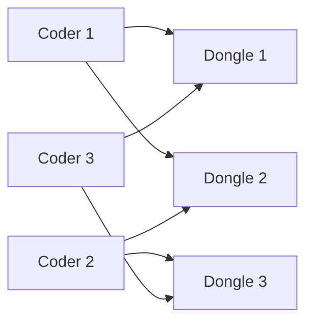
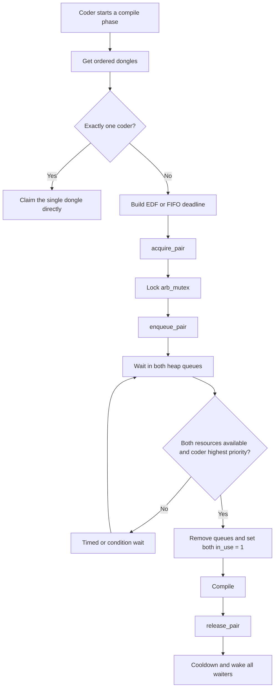
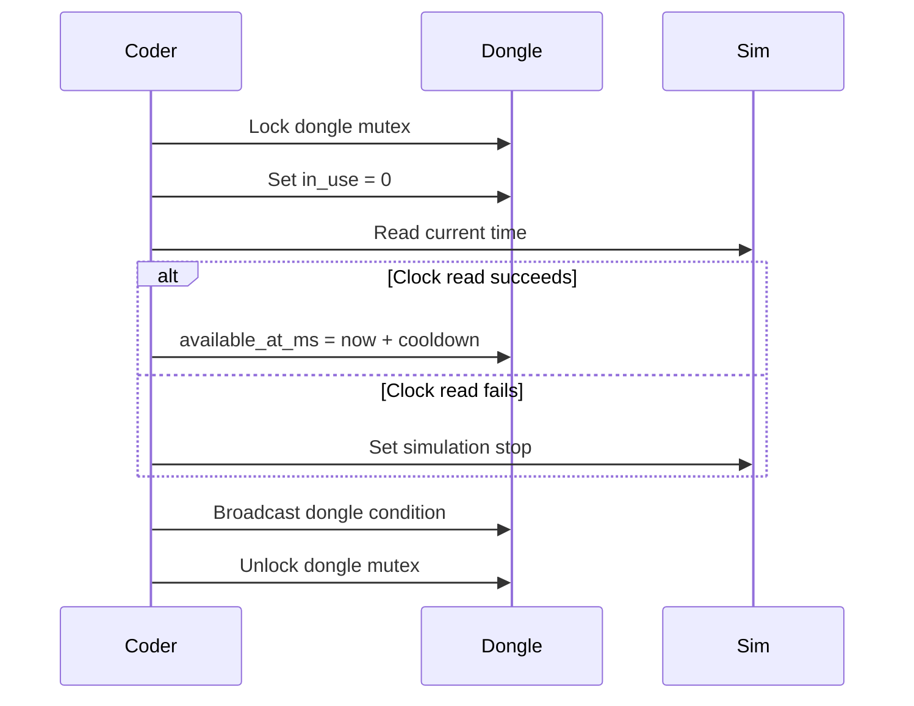
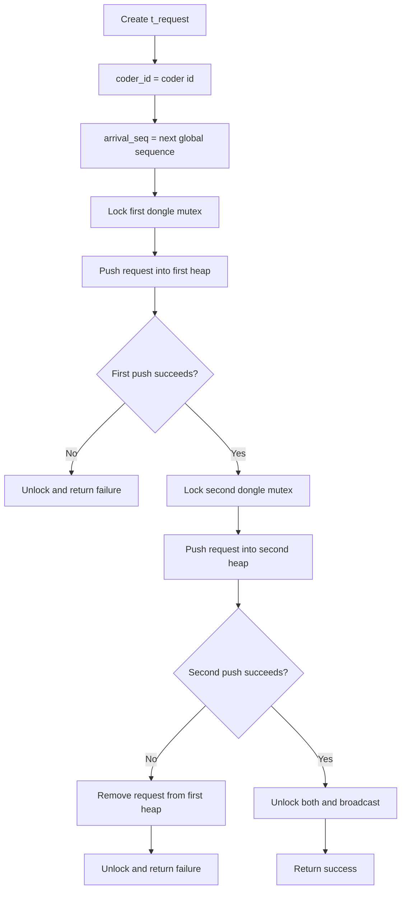
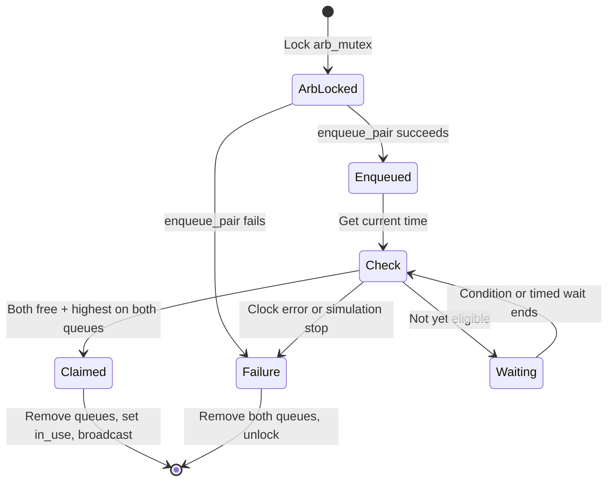
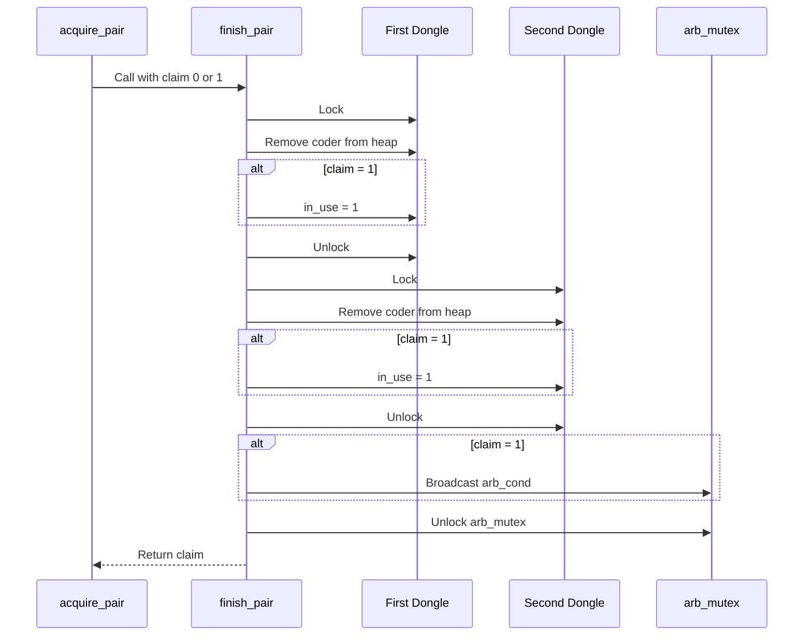
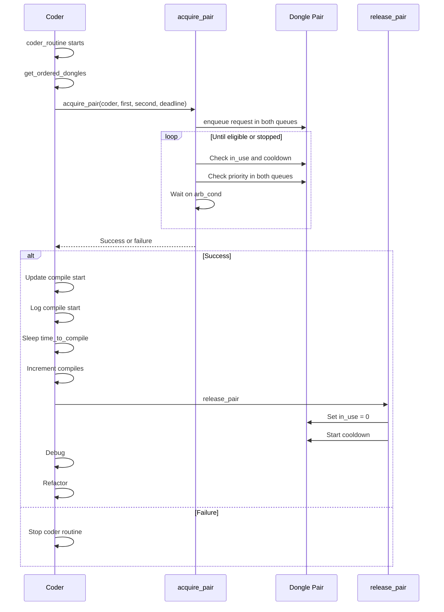

# Dongle Acquisition

This document explains the dongle-acquisition workflow implemented by
[`src/dongle.c`](/home/mnt/Documents/shcool_projects/codexion_2/src/dongle.c)
and
[`src/dongle_utils.c`](/home/mnt/Documents/shcool_projects/codexion_2/src/dongle_utils.c).

## 1. Purpose

A coder needs two adjacent dongles while compiling. A dongle represents a
shared, exclusive resource. The acquisition code must:

1. Put the coder into both dongle queues.
2. Prevent two coders from claiming the same dongle.
3. Prevent a coder from holding one dongle while waiting for the other.
4. Respect FIFO or EDF priority.
5. Wait for both resources and their cooldown periods.
6. Clean up queue entries when the request stops or fails.

For a simulation with more than one coder, coder `i` uses dongle `i` and dongle
`(i + 1) mod num_coders`. This forms a ring. For one coder, only one dongle is
used.



## 2. Main Request Flow



The caller in [`src/coder.c`](/home/mnt/Documents/shcool_projects/codexion_2/src/coder.c)
is `coder_compile_phase`:

1. `get_ordered_dongles` selects the pair.
2. If no pair exists, `handle_single_coder` handles the one-coder case.
3. Otherwise, `get_coder_deadline` calculates an EDF deadline.
4. `acquire_pair` blocks until both dongles can be claimed or the simulation
   stops.
5. On success, the compile phase starts, sleeps for the configured compile
   time, increments the compile count, and calls `release_pair`.

## 3. Dongle Functions

### `get_ordered_dongles`

This function returns the pair in ascending dongle-ID order. Consistent locking
and queue order help prevent opposite-thread lock orders.

```c
get_ordered_dongles(coder, &first, &second);
```

Its steps are:

1. If the simulation has one coder, set `first` to the coder's left dongle and
   set `second` to `NULL`.
2. Otherwise, compare `left_dongle->id` with `right_dongle->id`.
3. Store the lower-ID dongle in `first`.
4. Store the higher-ID dongle in `second`.

### `wake_all_dongles`

This function broadcasts to every waiting thread.

1. Lock `sim->arb_mutex`.
2. Broadcast `sim->arb_cond`.
3. Unlock `sim->arb_mutex`.
4. For each dongle:
   - Lock its dongle mutex.
   - Broadcast `dongle->cond`.
   - Unlock its dongle mutex.

The arbitration broadcast is the main wake-up mechanism; per-dongle
condition variables are also notified for completeness.

### `release_dongle`

This function releases one dongle.



The `available_at_ms` timestamp prevents immediate reuse during the configured
cooldown period.

### `release_pair`

`release_pair` releases an ordered pair safely.

1. Lock `sim->arb_mutex`, preventing competing acquisition checks while the
   pair is being released.
2. Release `second` if it is not `NULL`.
3. Release `first` if it is not `NULL`.
4. Broadcast `sim->arb_cond`.
5. Unlock `sim->arb_mutex`.

The second dongle is released before the first, matching the common
release-side order of the ordered pair.

### `enqueue_pair`

This function registers one request in both dongle heaps.



The request contains:

| Field | Meaning |
|---|---|
| `coder_id` | Identifies the waiting coder |
| `deadline_ms` | EDF deadline, if EDF scheduling is enabled |
| `arrival_seq` | Global FIFO/EDF tie-break and acquisition sequence |

If the second heap rejects the request, the code removes the request from the
first heap. This rollback prevents a partially enqueued request.

## 4. Acquisition Helpers

### `is_coder_runnable`

This helper decides whether a coder may evaluate a claim.

It returns `1` only when:

- Neither of the coder's dongles is currently in use.
- The current time is at or after the left dongle's `available_at_ms`.
- The current time is at or after the right dongle's `available_at_ms`.

In pseudocode:

```text
runnable =
    left_dongle is not in use
    AND right_dongle is not in use
    AND now >= left_dongle.available_at_ms
    AND now >= right_dongle.available_at_ms
```

### `is_highest_runnable`

This helper verifies priority on one dongle queue.

1. If the queue is empty, or this coder is already queue head, return `1`.
2. Scan every queue entry except this coder.
3. Obtain the other coder from `c->sim->coders`.
4. Ignore a queue entry if that other coder cannot currently run.
5. Compare priority with `is_higher_priority`.
6. If another runnable coder has higher priority, return `0`.
7. If no higher-priority runnable coder exists, return `1`.

The same check is performed separately for `first` and `second`. Therefore,
the current coder must be the highest runnable request on both queues.

The priority rule depends on `sim->scheduler`:

- `SCHED_TYPE_FIFO`: smaller `arrival_seq` has priority.
- `SCHED_TYPE_EDF`: earlier deadline has priority; `arrival_seq` breaks
  deadline ties; coder ID breaks remaining ties.

### `wait_step`

`wait_step` waits for a useful dongle state change.

1. If both dongles are currently free:
   - Start at the first dongle's availability time.
   - Advance to the later availability time if the second is available later.
   - If that availability time is later than `now`, perform a timed
     `pthread_cond_timedwait` until it is reached.
2. Otherwise, perform an ordinary `pthread_cond_wait`.
3. Return the wait result to `acquire_pair`.

When the wait completes, `acquire_pair` loops and repeats all checks.

## 5. `acquire_pair`

`acquire_pair` is the central acquisition function.



Detailed steps:

1. Build a `t_request` containing the supplied deadline.
2. Lock `c->sim->arb_mutex`.
3. Call `enqueue_pair`.
4. If enqueue fails:
   - Unlock `arb_mutex`.
   - Return `0`.
5. Enter the wait loop while the simulation is still running.
6. Read the current time.
7. If the clock fails, leave the loop.
8. Claim only if all of these are true:
   - `is_coder_runnable` passes.
   - `is_highest_runnable` passes for `first`.
   - `is_highest_runnable` passes for `second`.
9. Call `finish_pair(..., 1)` to claim both dongles and return `1`.
10. Otherwise, call `wait_step`.
11. Continue waiting unless the wait fails for an unexpected reason.
12. On exit, call `finish_pair(..., 0)` to remove both queue entries and return
    `0`.

## 6. `finish_pair`

`finish_pair` performs queue cleanup and optionally claims the pair.



This function assumes `arb_mutex` is already locked by `acquire_pair`.

## 7. Complete Compile Lifecycle



After acquisition, the pair remains exclusive until `release_pair` finishes.
The release operation sets both resources to the cooldown timestamp; waiting
coders cannot claim them until that timestamp and until `in_use` are cleared.

## 8. One-Coder Behavior

If `num_coders == 1`, `get_ordered_dongles` returns `second == NULL`. The normal
pair acquisition path is skipped. `handle_single_coder`:

1. Locks `arb_mutex`.
2. Locks the dongle mutex.
3. Sets `in_use = 1`.
4. Unlocks the dongle mutex and arbitration mutex.
5. Logs that it took a dongle.
6. Sleeps in 500-microsecond steps until the simulation stops.
7. Calls `release_pair(first, NULL, sim)`.

## 9. Synchronization Rules

| Shared state | Protection |
|---|---|
| Simulation stop flag | `sim_mutex` |
| Arbitration / waiter wake-up | `arb_mutex` and `arb_cond` |
| Individual dongle state and queue | Dongle `mutex` |
| Coder deadline/start/count | `state_mutex` |

Important rules:

- Request enqueue operations lock one dongle at a time.
- Queue checks run while `arb_mutex` is held.
- `finish_pair` removes both queue entries before it unlocks `arb_mutex`.
- A successful claim sets `in_use` for both resources.
- `release_pair` must be called after every successful acquisition.

## 10. Failure and Stop Paths

The function has several cleanup points:

- `enqueue_pair` rollback removes the first queue entry if the second enqueue
  fails.
- `acquire_pair` removes both queue entries when stopping or failing.
- `coder_compile_phase` releases the pair if updating the compile start fails.
- `release_pair` releases every successfully acquired resource.
- A clock error calls `finish_pair(..., 0)` or `sim_set_stop`, depending on
  where it occurs.

These paths ensure that an abnormal stop or allocation failure does not leave
the coder permanently present in both heap queues or holding an acquired
dongle.
