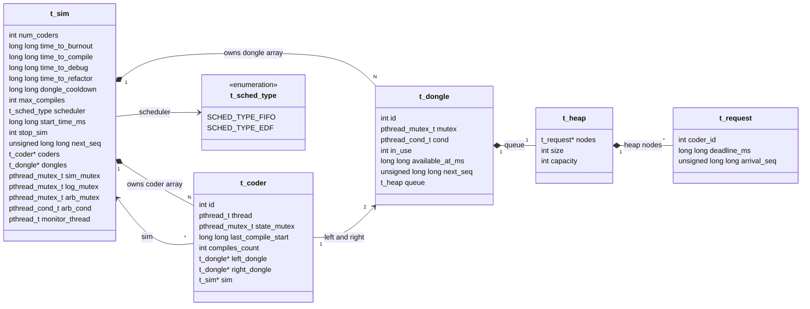
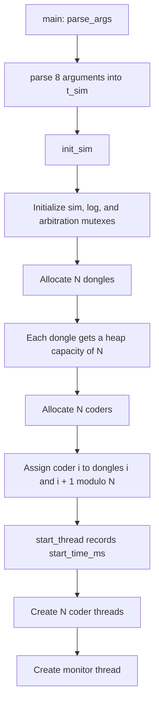
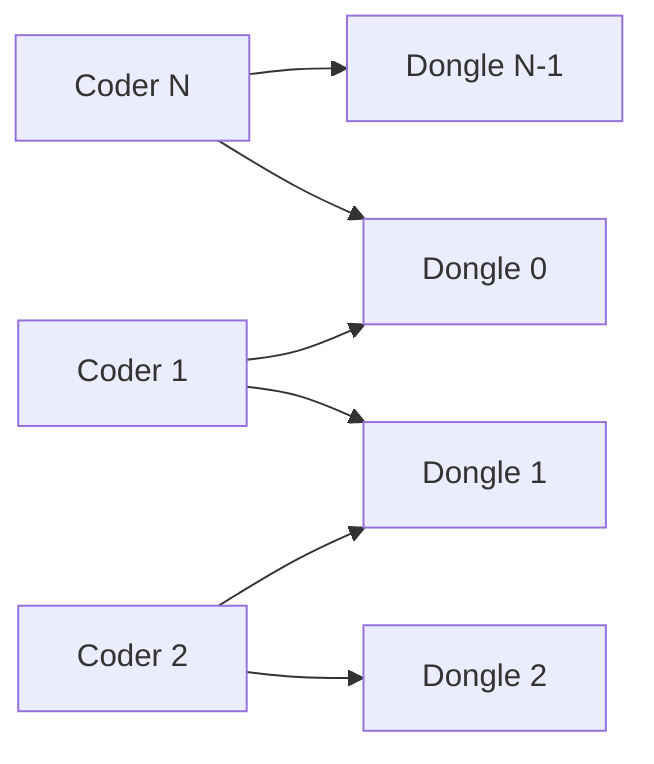
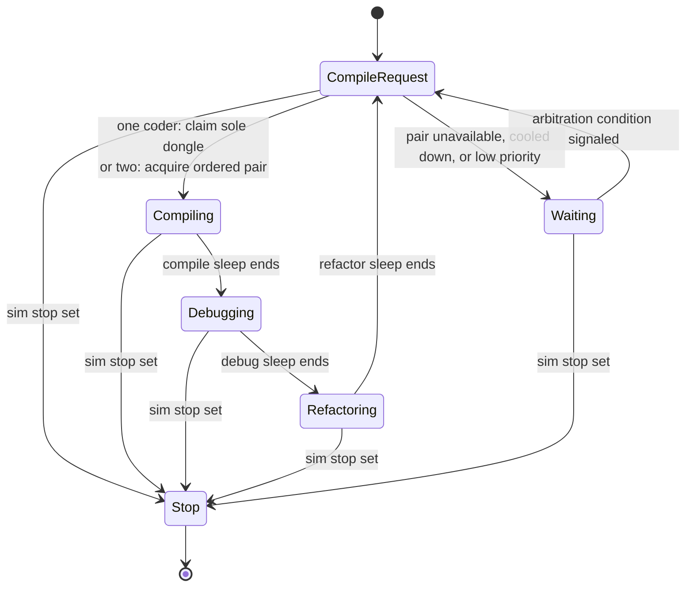
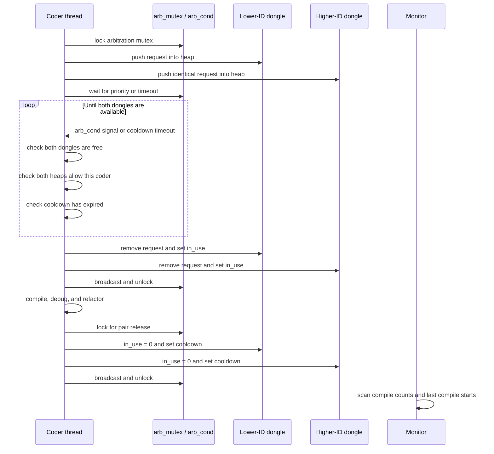
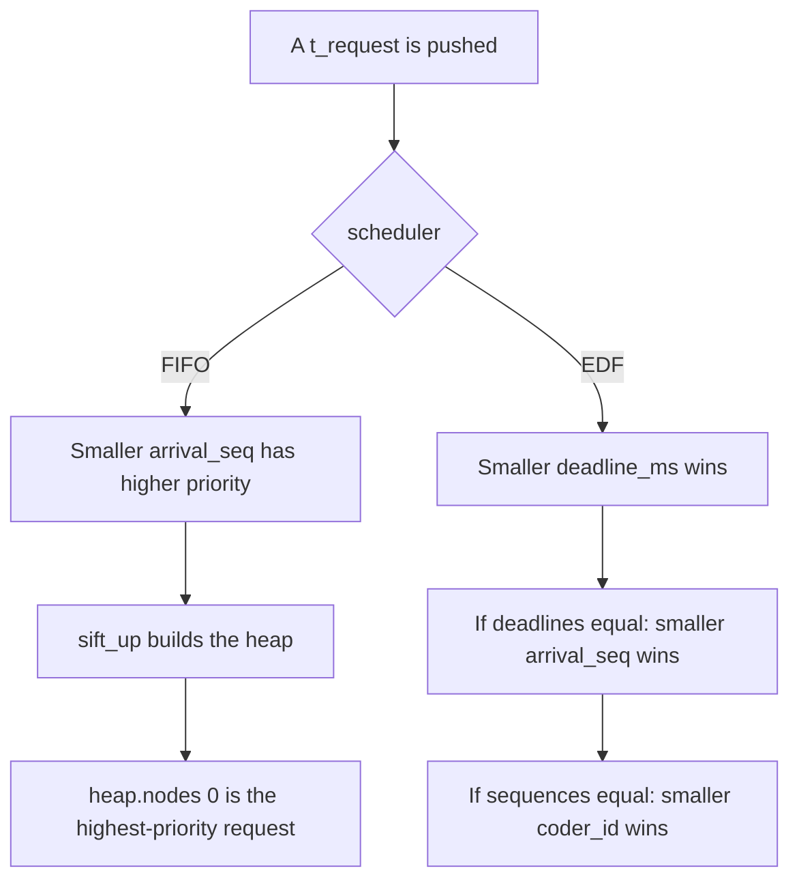
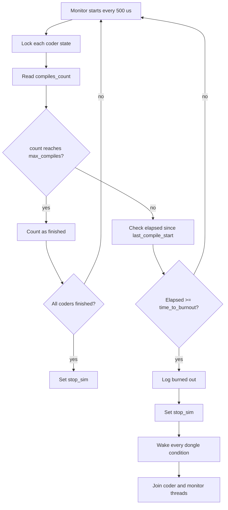
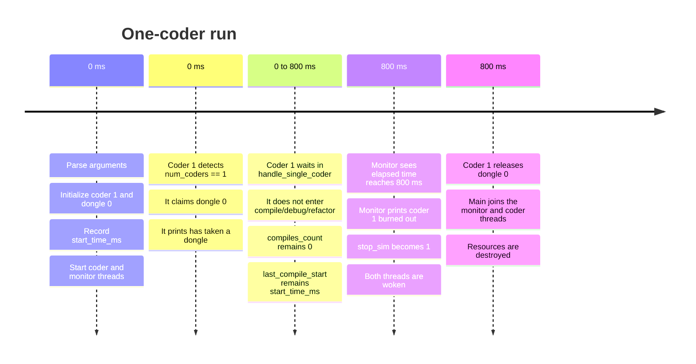
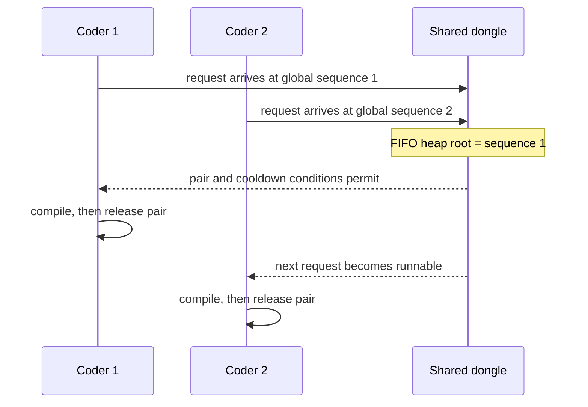

# Codexion Structures and Simulation Visualization

This document describes the implementation in:

- [`include/codexion.h`](../include/codexion.h)
- [`src/main.c`](../src/main.c), [`src/init.c`](../src/init.c), and [`src/init_2.c`](../src/init_2.c)
- [`src/coder.c`](../src/coder.c), [`src/dongle.c`](../src/dongle.c), and [`src/dongle_utils.c`](../src/dongle_utils.c)
- [`src/heap.c`](../src/heap.c) and [`src/sim_utils.c`](../src/sim_utils.c)
- [`src/monitor.c`](../src/monitor.c) and [`src/log.c`](../src/log.c)

## Struct relationship diagram



`t_request` is copied into the heap belonging to each of a coder's two dongles. Both copies have the same `coder_id`, `deadline_ms`, and `arrival_seq`; removing the coder from both queues releases the pair atomically from the arbitration view.

## Initialization and ownership



For `N` coders, the default topology is a ring:



The indexing in `init_coders` is:

- `coder[i].left_dongle = dongle[i]`
- `coder[i].right_dongle = dongle[(i + 1) % num_coders]`
- coder 1 is ring position 1, while array/dongle indexes start at 0

For the special case of one coder, `coder_routine` gets only the left dongle and does not enter pair acquisition.

## Coder state machine



In the normal two-dongle path:

1. Select the lower-index dongle as `first`.
2. Compute `deadline_ms = last_compile_start + time_to_burnout`.
3. Insert a request with a global arrival sequence into both dongle heaps.
4. Wait until the coder, both dongles, and the heap priorities permit acquisition.
5. Remove the coder's request from both queues and mark both dongles in use.
6. Log the pair as taken, sleep for `time_to_compile`, increment `compiles_count`, and release both dongles.
7. Debug for `time_to_debug`, then refactor for `time_to_refactor`, and repeat.

Release sets `available_at_ms = now + dongle_cooldown`. The cooldown is therefore the earliest time another coder may acquire that dongle.

## Pair arbitration



The `is_highest_runnable` check prevents a coder from claiming a pair while another runnable coder already has higher priority in the queue of that dongle.

## Heap priority



The EDF request deadline is a coder's last compile start plus `time_to_burnout`. Its effective meaning is: reach compilation before the monitor considers this coder burned out.

## Monitor and shutdown



`sim_set_stop` guards `stop_sim` with `sim_mutex`. Logging and monitor actions also synchronize with `log_mutex`.

## Example: `./codexion 1 800 200 200 200 10 0 fifo`

Argument mapping:

| Argument | Meaning | Value |
|---|---|---:|
| `argv[1]` | coder count | 1 |
| `argv[2]` | burnout limit | 800 ms |
| `argv[3]` | compile duration | 200 ms |
| `argv[4]` | debug duration | 200 ms |
| `argv[5]` | refactor duration | 200 ms |
| `argv[6]` | maximum compilations | 10 |
| `argv[7]` | dongle cooldown | 0 ms |
| `argv[8]` | scheduler | `fifo` |

### Step-by-step timeline



The observed output is:

```text
0 1 has taken a dongle
800 1 burned out
```

This happens because `handle_single_coder` deliberately holds the sole dongle until stop and does not increment `compiles_count`. Therefore:

- `time_to_compile`, `time_to_debug`, and `time_to_refactor` are not used in this one-coder branch.
- `max_compiles = 10` is not reached.
- `dongle_cooldown = 0` is irrelevant.
- `fifo` is irrelevant because no request heap is used by the one-coder branch.
- The burnout check terminates the run at 800 ms.

## Example: a multi-coder FIFO run

For `N >= 2`, the FIFO sequence is:



For EDF, replace "smaller sequence" with "smaller deadline". All heap operations are under the owning dongle mutex. Pair membership is additionally protected by `arb_mutex`.
